<p align="center">
  
</p>

<p align="center">
  <a href="https://prashanth.blog">prashanth.blog</a> &nbsp;·&nbsp;
  <a href="https://prashanth.blog/resume.html">résumé</a> &nbsp;·&nbsp;
  <a href="https://prashanth.blog/research.html">research</a> &nbsp;·&nbsp;
  <a href="https://linkedin.com/in/0xPrashanthSec">linkedin</a> &nbsp;·&nbsp;
  <a href="https://medium.com/@prashanth-pulisetti">medium</a>
</p>

<br>

### About

I lead a Security Operations Center and build its detection program. Before managing the SOC, I wrote detection rules from scratch: emulating attacker behaviour with **Atomic Red Team** and **CALDERA**, validating what fires, and mapping every rule to **MITRE ATT&CK**. With CRTE, CRTO and CRTP, I write detections from the attacker's side of the keyboard.

### Career

```
* a7f3c21 (HEAD -> main)   Mar 2026 – now     SOC Manager
* 5d09be4                  2025 – Feb 2026    SOC Team Lead
* c1e88a0                  2022 – 2025        SOC Specialist
* 8e2f61b                  2021 – 2022        SOC Engineer
* 0b4417d                  Jul 2019 – 2021    SOC Analyst          @ Eze Castle Integration
```

### Work

| Project | What it does |
|---|---|
| **[IOC Hunter](https://0xprashanthsec.github.io/IOCQuery/)** | Turns IOCs from threat-intel blogs into Elastic SIEM hunting queries. |
| **Elastic detection library** | 300+ rules from real malware and actor TTPs, tuned for low noise. [Six are public →](https://prashanth.blog/#detections) |
| **Open-source contributor** | Detection and emulation content for [Elastic](https://github.com/elastic/detection-rules), [Atomic Red Team](https://github.com/redcanaryco/atomic-red-team) and [SigmaHQ](https://github.com/SigmaHQ/sigma). |

### Stack

**SIEM & EDR** &nbsp; Elastic · Microsoft Sentinel · Splunk · CrowdStrike · SentinelOne · Microsoft Defender

**Detection** &nbsp; Sigma · KQL · EQL · ES|QL · YARA · MITRE ATT&CK

**Purple team & cloud** &nbsp; Atomic Red Team · CALDERA · Cobalt Strike · Active Directory · Microsoft 365 · Entra ID

### Latest writing

- **[ClickFix + VLC DLL Sideloading: How Attackers Are Hiding RATs Inside a Signed Video Player](https://prashanth-pulisetti.medium.com/clickfix-vlc-dll-sideloading-how-attackers-are-hiding-rats-inside-a-signed-video-player-f10a61ba1079)** <sub>Jun 2026</sub>
- **[BlueKit: The Phishing Kit That Makes MFA Irrelevant](https://prashanth-pulisetti.medium.com/bluekit-the-phishing-kit-that-makes-mfa-irrelevant-738fe67959d7)** <sub>Jun 2026</sub>
- **[Hunting ADCS Attack Paths: Detecting ESC1–ESC6 Privilege Escalation](https://medium.com/@prashanth-pulisetti/hunting-adcs-attack-paths-detecting-esc1-esc6-privilege-escalation-in-active-directory-4259ac0e46c4)** <sub>Jun 2026</sub>

<sub>[All posts →](https://prashanth.blog/research.html)</sub>

### Recognition

**Oracle** Hall of Fame &nbsp;·&nbsp; **NCIIPC**, Govt. of India ×15 &nbsp;·&nbsp; **Dell · Trip Advisor · Cybrary** bug bounties &nbsp;·&nbsp; **Top Performer** 2022, 2023
<br>
<sub>CRTE · CRTO · CRTP · CHFI · eJPT &nbsp;|&nbsp; M.Sc. Cyber Security, IIITMK</sub>

### Contact

```bash
echo cHJhc2hhbnRoLmluYm94QHR1dGEuY29t | base64 -d
```

<br>
<p align="center"><sub>built to defend · engineered to detect</sub></p>
